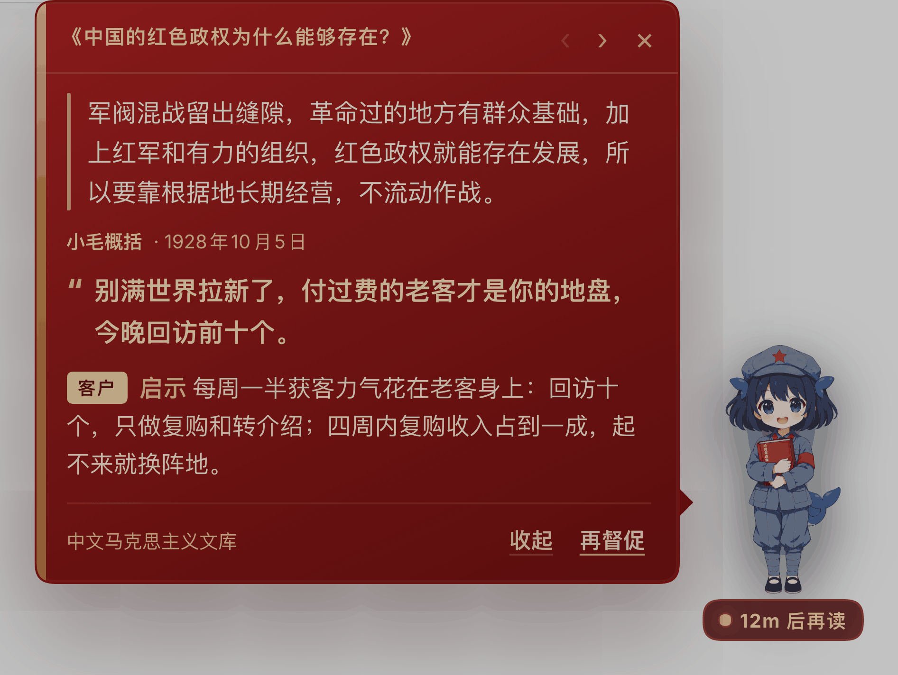

# Xiao Mao, the whale-girl desktop pet — one essay an hour in the corner of DSH

A red-book speech bubble plus four sprite frames: every card = a cited line from a Mao essay
(with source date) + one line of pressure for you + one rule you can verify today, capped at
**200 characters** in total.

## Install

```bash
dsh plugin --profile web add dsh-plugin-maoxuan-pet
# then restart dsh web (Ctrl+C, then `dsh web` again) and reload the page
```

Requirements: DSH `>=0.2.1-rc.2 <0.3.0`, Node `^22.19.0 || >=24.0.0`. Web shell only.
Source install / uninstall / troubleshooting: [docs/INSTALL.md](docs/INSTALL.md).

## Stand on the real desktop (macOS, optional)

The web pet lives inside the DSH window and disappears when it is minimized — a hard browser
sandbox boundary. `desktop/` ships a **standalone-process pet shell** (pure Swift + system
WebKit, ~450 lines, zero dependencies): transparent, always-on-top, visible on all Spaces.
Minimize DSH or close the window entirely — she stays. The plugin still owns the brain (the
hourly essay reading); the shell only relocates the display.

```bash
npm run pet:build   # swiftc build, a few seconds
npm run pet         # she stands at the bottom-right of your screen
```

Click to open the red-book card, drag to move (position is remembered), right-click for
reset/quit. See [desktop/README.md](desktop/README.md) for details.

## Screenshot



The bubble hangs to the **left** of the pet, so the pet never moves. Opening the card marks it
read (the unread badge disappears); `‹ ›` walks back through history; `收起` / `再督促` are
text-only buttons. New bubbles pop up on the hour.

## Xiao Mao

| standing | talking | blinking | reading |
|:--:|:--:|:--:|:--:|
|  |  |  |  |

The four frames share one canvas and one foot line, so switching never makes her jump. A
fan-made character; not affiliated with DeepSeek.

## What it does

| Ability | Behaviour |
|---|---|
| **One essay an hour** | 33 bundled public-domain essays of Mao Zedong, rotated so she doesn't reread the last one; templates rotate between `quote` / `excerpt` / `summary` |
| **Never invents a quote** | `quote` / `excerpt` must match the corpus verbatim, otherwise she falls back to `summary`; if the model retells the original, the whole card is dropped |
| **Six angles** | customers / projects / organisation / cash flow / decisions / self-discipline — one per card, with a hard rule and a way to verify it |
| **You can ask back** | ships the `maoxuan-pet` ("Selected Works startup advisor") preset and the `maoxuan-vademecum` skill; start a new session and ask "given Mao, what should I do next?" |
| **Doesn't nag** | quiet hours (02:00–08:00 by default), daily cap (24), remembered position, unread badge clears only when read, `‹ ›` history |
| **Degrades gracefully** | no credentials / timeout / non-JSON → a local excerpt labelled 「离线摘录」, never passed off as model output |

## Config

```yaml
- id: dsh-maoxuan-pet
  config:
    enabled: true
    everySeconds: 3600      # hourly
    firstDelaySeconds: 90
    quietHours: [2, 8]      # no pings between 02:00 and 08:00 local time
    dailyLimit: 24
    maxBubbles: 40
    headless: true          # false = only local excerpts, zero model calls
    dshBin: dsh
    profile: headless       # since v0.2.3 the host GUI's model config is
                            # bridged in automatically (official/relay, no setup)
    timeoutMs: 180000
    businessContext: "40, indie developer, small-tool SaaS"
```

## Corpus

- 33 essays, all `verified: true`, covering volumes I–V;
- texts come from the [Chinese Marxist Internet Archive](https://www.marxists.org/chinese/maozedong/index.htm), bundled for personal study only;
- refresh / extend: `npm run corpus`;
- licensing and redistribution limits: [NOTICE](NOTICE) and [corpus/README.md](corpus/README.md).

## Known limitations

- web pet only (`dsh.client.platform: web`) — no pet in the terminal / TUI; on macOS use the
  desktop shell above to leave the window;
- the desktop shell is macOS-only (system WebKit); Windows / Linux need a Tauri 2 / Electron
  shell — `pet.html` can be reused as-is;
- the timer only runs while this `dsh web` process is alive; a stopped process does not catch up,
  and on restart `nextRunAt` decides whether to run once more;
- each headless generation is a fresh session (no shared context): stable, but she "doesn't
  remember what she said yesterday" — hence the last 6 nudges are passed into the prompt to avoid
  repeats.

## License and third-party content

- **Code**: MIT — see [LICENSE](LICENSE).
- **Bundled corpus** (`corpus/`, 33 essays): **not MIT.** Texts come from the
  [Chinese Marxist Internet Archive](https://www.marxists.org/chinese/maozedong/index.htm) and
  are bundled for personal study only. See [NOTICE](NOTICE). Delete `corpus/articles/` to drop it;
  quote/excerpt templates then degrade safely to summary.
- **Sprites and icon** (`assets/`): a fan-made "whale girl" character — not affiliated with
  DeepSeek. See [assets/PROVENANCE.md](assets/PROVENANCE.md).

This plugin is a reading/nudging tool that treats the essays as a source of product and
entrepreneurship method. It is not affiliated with DeepSeek or any publisher, and it is not
political advocacy.

---

Package `dsh-plugin-maoxuan-pet` · [中文](README.md) · technical details in [docs/](docs/): [API-CONTRACT.md](docs/API-CONTRACT.md) · [CONTENT-FRAMEWORK.md](docs/CONTENT-FRAMEWORK.md) · [verify/README.md](verify/README.md)

[](https://github.com/yuna78/dsh-maoxuan-pet/actions/workflows/verify.yml) [](https://www.npmjs.com/package/dsh-plugin-maoxuan-pet)
