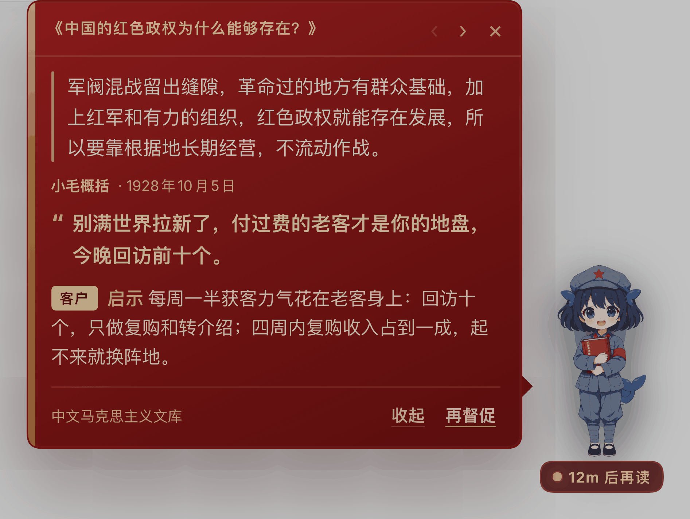

# dsh-maoxuan-pet · 鲸鱼娘·小毛

[](https://github.com/yuna78/dsh-maoxuan-pet/actions/workflows/verify.yml) [](https://www.npmjs.com/package/dsh-plugin-maoxuan-pet)

> 一只穿红军制服、抱着《毛泽东选集》的鲸鱼娘，住在 DSH 的 Web 界面右下角。
> 每小时读一篇毛选，把它变成一句针对**你的**创业处境的思想 + 一句督促，
> 并且随时可以开一个新会话问她：根据毛选，我这一步该怎么走。

| 需求 | 实现 |
|---|---|
| 宠物形态、鲸鱼娘、红军制服、手捧毛选 | `assets/` 里 4 帧 AI 立绘（idle / talk / blink / read，640×1348 RGBA，红封面竖排「毛泽东选集」可辨），`client.js` 在 `shell.overlay` 槽位渲染悬浮宠物 |
| 每小时帮我读毛选 | Host 定时器按小时读 `corpus/` 里的下一篇（轮转、避开刚读过的） |
| 每小时生成思想 / PUA 我的话，出现在气泡里 | 每次生成 `spawn` 一个 `dsh --profile headless` 对话，拿到结构化 JSON 后推给气泡 |
| 有个 preset，能直接问「根据毛选我该怎么做」 | `maoxuan-pet`「毛选创业参谋」preset + 运行时注册的 `maoxuan-vademecum` skill 指向内置语料 |

## 它到底怎么工作

```
┌─ DSH Web (dsh web) ───────────────────────────────────────────┐
│                                                               │
│  index.js  (Host)                                             │
│   ├─ 状态：$DSH_HOME/storages/dsh-maoxuan-pet.json  (原子写)   │
│   ├─ 定时器：ctx.timeout 链 → quietHours / dailyLimit 约束      │
│   ├─ 语料：corpus/index.json → 轮转挑一篇 verified 的           │
│   ├─ 生成：spawn `dsh --profile headless --json "<prompt>"`    │
│   │        └ 失败/超时/非 JSON → 本地摘录降级（标注“离线摘录”） │
│   ├─ 路由：/api/dsh-maoxuan-pet.{state,generate,dismiss,       │
│   │        asset,corpus}                                       │
│   └─ skill：把 corpus/ 注册成 maoxuan-vademecum                │
│                                                               │
│  client.js  (Web)                                             │
│   └─ shell.overlay → 宠物 + 气泡，20s 轮询 / 生成中 3s 轮询     │
│                                                               │
│  cordis.patch.yml                                             │
│   ├─ 插件行 dsh-maoxuan-pet                                    │
│   └─ preset-maoxuan-pet「毛选创业参谋」(persona + skill + 工具)  │
└───────────────────────────────────────────────────────────────┘
```

气泡里的每条内容都是**结构化**的，而且**整条不超过 200 字**：

| 字段 | 含义 |
|---|---|
| `template` | 三种模板轮转：`quote` 金句 / `excerpt` 文章节选 / `summary` 小毛概括 |
| `cite` | 上面那一句（逐字核对过；`summary` 是小毛的概括，不加引号），带来源链接 |
| `axis` | 启示落点，六选一：客户 / 项目 / 组织 / 现金流 / 决策 / 自律 |
| `pua` | 小毛对你说的一句话（≤40 字，第一人称；**模型复述原文时会整条丢弃**，气泡只留引文 + 启示） |
| `lesson` | 启示：一条硬规则 + 怎么验证（≤100 字，围绕 `axis`） |
| `chars` | 引文 + pua + 启示的实际字数，Host 保证 ≤200 |
| `mode` | `headless` = 模型生成；`offline` = 本地摘录降级（UI 会标「离线摘录」） |

框架是这样设计的（`template × axis` 矩阵，而不是每次同一套）：

```
取材  3 种：原文金句 / 文章节选（逐字取整句）/ 小毛概括（模型自己概括）
落点  6 种：客户 · 项目 · 组织 · 现金流 · 决策 · 自律
语气  3 种：sharp 硬话 · calm 冷静 · urgent 催
```

- 模板游标 `templateCursor` 持久化在状态里，按 3 种循环；不会因为历史条数封顶而卡住；
- `axis` 在 prompt 里指定，并尽量避开上一条的落点；
- 引文句式/节选都在 `corpus/articles/<id>.md` 里做 `isVerbatim` 逐字校验，校验不过就退到 `summary`，绝不编造；
- 所有字段最后过一遍 `fitLesson`，把「引文 + pua + 启示」压进 200 字。

为什么落点是 6 类名词、而「动作」不单列一类、字数预算怎么分、真实生成样例长什么样，
见 [docs/CONTENT-FRAMEWORK.md](docs/CONTENT-FRAMEWORK.md)。语料能不能支撑 Quote 模板，跑一条审计就知道：

```bash
node scripts/audit-corpus-coverage.mjs   # 33 篇：金句逐字命中 33/33，节选可用 32/33
```

### 界面行为（这一版按用户逐条反馈定的）

（效果图见下方[「长什么样」](#长什么样)）

- **红皮书卡片**：深红封面 + 烫金书脊，正文米白；卡片里不出现蓝/紫/绿，落点 chip 用同一族暖金。滚动条也换成烫金滑块 + 深红轨道。
- **宠物不动**：卡片绝对定位在宠物左侧（宠物被拖到靠左边缘时自动翻到右侧），点开/收起只让气泡出现或消失，宠物坐标不变。
- **打开即已读**：卡片真正显示的那一刻才把这条标已读，宠物右上角的未读数随之消失；正在读的那条会被"钉住"，Host 把 `current` 推进到下一条时，眼前的文字不会跳。
- **没有未读也有内容**：全部读过后再点开，仍然停在上一次产出的那张卡，`‹ ›` 可以往前翻历史。
- **定时弹出**：整点生成的新气泡会自己弹出来；手动关掉的那条不会自己再弹，等下一条。
- **按钮无盒子**：`收起` / `再督促` 是纯文字 + 下划线，没有背景和边框。

## 安装

从 npm（推荐）：

```bash
dsh plugin --profile web add dsh-plugin-maoxuan-pet
# 然后 Ctrl+C 停掉 dsh web，再重新 `dsh web`，刷新页面
```

从源码（本目录）：

```bash
node install.mjs --dry-run   # 先看要改什么
node install.mjs             # 写入 profile 清单 + pnpm link
```

两种方式装完都要**手动重启** `dsh web`（Ctrl+C 后重新 `dsh web`），刷新页面。

完整步骤、回滚、排错见 [docs/INSTALL.md](docs/INSTALL.md)；内部接口见 [docs/API-CONTRACT.md](docs/API-CONTRACT.md)。

### 长什么样



深红封面 + 烫金书脊的气泡挂在宠物左侧，宠物自己不动；打开即已读（右上角未读数消失），
`‹ ›` 可以往回翻历史；定时生成的新气泡会自己弹出来，`收起` / `再督促` 是纯文字按钮。

截图由 `scripts/hero-shot.mjs` 生成（需要本地 headless Chrome + 一个 dsh web 实例），
换版式时重拍即可。


## 配置

```yaml
- id: dsh-maoxuan-pet
  config:
    enabled: true
    everySeconds: 3600      # 每小时
    firstDelaySeconds: 90   # 启动后 90s 先来一次
    quietHours: [2, 8]      # 本地时间 02:00–08:00 不打扰
    dailyLimit: 24          # 每天最多生成次数（防失控）
    maxBubbles: 40
    headless: true          # false = 只用本地摘录，不花模型调用
    dshBin: dsh
    profile: headless
    timeoutMs: 180000
    businessContext: |-
      用户是一位正在创业的独立开发者……
```

## 用 preset 问「根据毛选我应该怎么做」

新建会话 → preset 选 **「毛选创业参谋」**（id `maoxuan-pet`）→ 直接问。它会：

1. 加载 `maoxuan-vademecum` skill（知道语料在哪、怎么检索）；
2. 用 `read` 打开对应篇目**全文**，取逐字原文；
3. 按固定结构回答：原文金句（篇名 + 时间）→ 当时的问题与论证 → 方法 → 你的处境 → 今天能做的一步；
4. 核不到原文就明说，不编造。

`maoxuan-vademecum` skill 是运行时由 Host 注册的（内容来自 `skill/maoxuan-vademecum/SKILL.md` + 语料索引），所以它永远指向当前安装目录，不写死路径。

## 毛选语料

- **33 篇，全部 `verified: true`**，覆盖第一至第五卷（目录页实际解析出 329 篇，按“与创业最相关”白名单取 33 篇全文）；
- 来源：中文马克思主义文库公开电子文本（https://www.marxists.org/chinese/maozedong/index.htm），GB2312 页面按 gb18030 解码，逐篇记录 URL 与抓取时间；
- 结构：`corpus/index.json` 索引 + `corpus/articles/<id>.md` 全文；每条带 `quote`（逐字核对）、`summary`、`businessAngle`、`verified`；
- 重新抓取 / 扩充：`npm run corpus`（见 `scripts/fetch-corpus.mjs`）；
- 版权：文本版权归原权利人，此处仅用于个人学习研究，不用于售卖，详见 `corpus/README.md` 与 `LICENSE`。

## 开发与验证

```bash
npm test            # node verify/smoke.mjs
npm run test:contract
node verify/host.test.mjs   # 假 ctx 端到端：路由、状态、降级、原子写
node --check index.js
node --check client.js
```

验证边界见 [verify/README.md](verify/README.md)：单元与端到端测试不联网、不启动子进程、不花模型调用。

真实链路另做过一次隔离启动验证（`DSH_HOME=/tmp/... dsh web --port 3099`，不碰当前 GUI 的 profile）：

| 验证 | 结果 |
|---|---|
| `--dump-config` 组装 | 插件行与 `preset-maoxuan-pet` 都在组合后的配置里 |
| `GET /api/dsh-maoxuan-pet.state` | 200，`corpus.count=33`，`nextRunAt` 已排定 |
| `GET /api/dsh-maoxuan-pet.asset?name=idle` | 200，`image/png`，640×1348 RGBA |
| 页面 boot payload | 含 `dsh-plugin-maoxuan-pet/client.js`，实际拉到的 bundle 里含本插件代码且可解析 |
| `POST /api/dsh-maoxuan-pet.generate`（真实 headless） | 61s，`mode: "headless"`，返回结构化气泡（篇名/金句/思想/启示/督促/动作） |
| 失败降级 | 无凭据时 5.5s 内降级为 `mode: "offline"` 并写入 `lastError` |

### 两个真实踩到的坑（已在 docs/API-CONTRACT.md §6 详述）

1. 自定义路由必须显式 `requestBody: 'buffered'`，否则 GET 会被 Host 直接 400、handler 不被调用；
2. `ctx.timeout()` 必须在 `inject` 里声明 `'timer'`，否则真实 `dsh web` 启动 fatal。

## 已知限制

- 只支持 Web 界面（`dsh.client.platform: web`），终端/TUI 里没有宠物；
- 定时器只在这个 `dsh web` 进程活着时走；进程停了不会补跑，重启后按 `nextRunAt` 决定是否补一次；
- headless 生成每次是一个独立会话（不复用上下文），好处是稳定、坏处是“它不记得昨天说过什么”——所以 prompt 里带了最近 6 条督促用来避免重复；
- 生图是 AI 生成，中文“毛泽东选集”可能不是逐字可辨，详见 `assets/PROVENANCE.md`；
- DeepSeek「鲸鱼娘」是民间同人设定，本项目不是官方素材，也不代表 DeepSeek 立场。

## License

- **代码**：MIT，见 [LICENSE](LICENSE)。
- **内置毛选语料**（`corpus/`）：**不是 MIT**。文本来自[中文马克思主义文库·毛泽东](https://www.marxists.org/chinese/maozedong/index.htm)，著作权归原作者与出版方，
  本项目仅作个人学习、研究之用的整理，不构成再出版或商业授权。详见 [NOTICE](NOTICE) 与 [corpus/README.md](corpus/README.md)。
- **立绘**（`assets/`）：AI 生成（gpt-image-2，2026-10-31），民间同人形象「鲸鱼娘·小毛」，与 DeepSeek 官方无关。生成记录见 [assets/PROVENANCE.md](assets/PROVENANCE.md)。
- 本项目与 DeepSeek、毛泽东著作出版方均无隶属关系；内容用于产品与创业方法论的阅读辅助，不作政治宣传。
